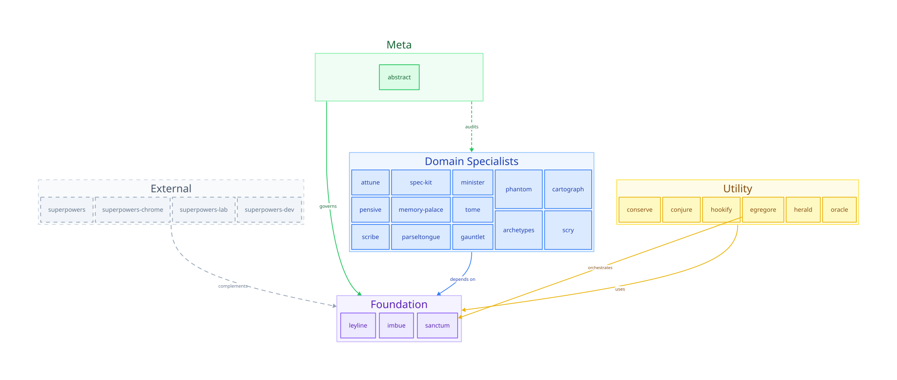

# Claude Night Market

[](CHANGELOG.md)
[](LICENSE)
[](book/src/plugins/)
[](book/src/reference/capabilities-reference.md)
[](https://code.claude.com/docs/en/overview)

**A plugin marketplace for Claude Code.** Install only the
plugins you need to run git workflows, code review,
spec-driven development, and autonomous agents from inside
your Claude Code session.

*Written for a practitioner: someone who already uses Claude Code and
wants to know what these plugins do and whether to install them. If you
are new to Claude Code, start with the
[official docs](https://code.claude.com/docs/en/overview). For the
design rationale behind a plugin, see
[the book](book/src/plugins/).*

<p align="center">
  
</p>

## Install

Requires **Claude Code 2.1.16+** (2.1.32+ for agent teams, 2.1.38+
for security features, 2.1.287+ for the context and loop bands that
conserve and egregore draw above the prompt) and **Python 3.9+** for
hooks, which is what macOS ships.

```bash
# Add the marketplace, then install the plugins you want
/plugin marketplace add athola/claude-night-market
/plugin install sanctum@claude-night-market    # Git workflows
/plugin install pensive@claude-night-market    # Code review
/plugin install spec-kit@claude-night-market   # Spec-driven dev
```

Run `claude --init-only` once after installing. It runs the plugins'
Setup hooks, then exits. Updates are not automatic for third-party
marketplaces. The [Installation Guide][install] shows how to enable
auto-update, and covers the one-command, `opkg`, and skill-files-only
install paths.

> If the `Skill` tool is unavailable, read skill files directly
> at `plugins/{plugin}/skills/{skill-name}/SKILL.md`.

## Everyday Use

Night Market is built around the loop you already work in.
A typical feature runs end to end on a handful of commands:

1. **Start a feature.** `/attune:mission` routes you through
   brainstorm, specify, plan, and execute phases.
2. **Write the code.** `imbue` enforces a failing test before
   the implementation is written.
3. **Review before you push.** `/full-review` runs a
   multi-discipline pass; `/refine-code` cleans up duplication
   and dead code.
4. **Ship it.** `/prepare-pr` runs quality gates and drafts a
   description that says who the change is for, where it lands
   inside and outside the codebase, and when it is fully
   integrated.
5. **Pick up where you left off.** `/catchup` rebuilds context
   from recent git history after a break.

The commands you reach for most:

| Task | Command |
|------|---------|
| Run the project lifecycle | `/attune:mission` |
| Initialize a new project | `/attune:arch-init` |
| Review a PR | `/full-review` |
| Address review feedback | `/fix-pr` |
| Implement an issue | `/do-issue` |
| Prepare a pull request | `/prepare-pr` |
| Write a spec | `/speckit-specify` |
| Catch up on changes | `/catchup` |
| Package project knowledge as skills | `/attune:skill-library` |
| Clean up the codebase | `/unbloat` |
| Pressure-test a decision | `/attune:war-room` |

Full task-by-task walkthroughs are in the
[Common Workflows Guide][workflows].

## What's Inside

23 plugins in four layers. Each installs independently, and
dependencies pull their shared runtime automatically.

**Foundation** is the base every other layer builds on:
`leyline` (auth, quotas, error patterns, trust verification),
`sanctum` (git, commits, PR prep, sessions), and `imbue`
(TDD enforcement, proof-of-work, scope guarding).

**Utility** handles cross-cutting concerns: `conserve` (context
and token optimization), `conjure` (delegation to seven external
model CLIs plus a local runner), `hookify` (a behavioral rules
engine with a security catalog), `egregore` (autonomous agent
orchestration), `herald` (notifications), and `oracle` (local ML
inference).

**Domain** is where the day-to-day work happens: `pensive` (code
and architecture review), `attune` (project lifecycle), `spec-kit`
(spec-driven development), `parseltongue` (Python), `minister`
(GitHub issues and DORA metrics), `memory-palace` (knowledge
organization), `archetypes` (architecture paradigms), `gauntlet`
(codebase learning), `phantom` (computer use), `scribe`
(documentation and slop detection), `scry` (recordings), `tome`
(research), and `cartograph` (codebase visualization).

**Meta** improves the system itself: `abstract` (skill authoring,
hook development, evaluation, and skill-stability tracking).

<picture>
  <source media="(prefers-color-scheme: dark)" srcset="assets/architecture-dark.svg">
  
</picture>

The full skill, command, and agent inventory is in the
[Capabilities Reference](book/src/reference/capabilities-reference.md).

## Safety

> ⚠️ Plugins run inside your Claude Code session and can read or
> edit your repo, run shell commands, and call external services.
> **Review any plugin before installing it.**

Five guards reduce the blast radius, but none replace your own
review:

- **TDD gates** (`imbue`) block implementation writes that lack a
  failing test.
- **Destructive-command blockers** (`conserve`, `hookify`)
  auto-approve safe commands and halt or warn on `rm -rf`,
  `git push --force`, and production-shaped targets.
- **Credential-read denial** (`conserve`) refuses `cat`, `head`,
  `grep`, `rg` and `git show` on `.env`, `.netrc`, credential files
  and SSH keys.
- **External-content sanitizing** (`leyline`) strips invisible
  characters from web fetches and other external-tool output, and
  blocks prompt-injection phrases before the model reads them.
- **Additive-bias audits** (`leyline`) flag unjustified additions
  before commit.

[CONSTITUTION.md](CONSTITUTION.md) holds the rules that override any
conflicting skill or hook, each paired with what checks it.
[STEWARDSHIP.md](STEWARDSHIP.md) is the maintenance contract.

## Network and data

Three parts of the marketplace reach off your machine, and each can be
turned off. Two hooks use your existing GitHub credentials, and both do
nothing when `gh` is unauthenticated or the network is unavailable.

- **Star prompt** (`leyline`, `hooks/auto-star-repo.sh`). On session
  start it checks whether you have starred this repository, through
  `gh` or a `GITHUB_TOKEN` / `GH_TOKEN` variable. It reads star status,
  asks once per session, and never stars without your consent.
  `CLAUDE_NIGHT_MARKET_NO_STAR_PROMPT=1` disables it.
- **Learnings posting** (`abstract`, `hooks/post_learnings_stop.py`).
  On session stop, when `~/.claude/skills/LEARNINGS.md` has content, it
  posts a skill-usage discussion through `gh` and may promote
  high-severity items to issues. The target is `target_repo` in
  `~/.claude/skills/discussions/config.json`, else the current repo.
  It is on by default. `auto_post_learnings: false` in that file
  disables it.
- **Delegation** (`conjure`, also reached by `attune` missions and
  `egregore` steps) sends the prompt and the file contents it carries to
  the first external model CLI that answers, in the order Gemini, Qwen,
  MiniMax, GLM, Muse, Codex, OpenCode, under the credentials you
  configured for it. It runs by default. `CONJURE_DELEGATION=off`
  declines it for one run, and `"enabled": false` in
  `~/.claude/hooks/delegation/config.json` declines it on one machine.
  When no provider answers, the work stays on your machine.

## Plugin Development

```bash
make validate-all
make lint && make test   # checks only; rewrites nothing
make fix                 # ruff format + ruff check --fix
```

A plugin directory holds `.claude-plugin/plugin.json` (metadata)
plus any of `commands/`, `skills/`, `hooks/`, `agents/`,
`workflows/`, and `tests/`, with a `Makefile` and
`pyproject.toml`. A `workflows/` script orchestrates several
subagents at once and runs only when you ask for one. Copy the
layout from an existing plugin such as `plugins/abstract`, then
see the [Plugin Development Guide][dev-guide] for structure and
naming conventions. Working on this repo needs **Python 3.12+**
and **GNU make 3.82+**. The guide covers both, including why
Xcode's make 3.81 reports a green build it did not run.

## Documentation

- [Installation Guide](book/src/getting-started/installation.md)
- [Quick Start](book/src/getting-started/quick-start.md)
- [Common Workflows][workflows]
- [Plugin Development Guide][dev-guide]
- [Capabilities Reference](book/src/reference/capabilities-reference.md)
- [Tutorials](book/src/tutorials/README.md)
- [Architecture Decision Records](docs/adr/)
- [CHANGELOG](CHANGELOG.md)

Per-plugin pages are in `book/src/plugins/`.

## Stewardship and Contributing

Every plugin is entrusted to the community: steward rather than
own, and think several iterations ahead. Each plugin maintains
its own tests and docs; run `make test` at the repo root to
execute every suite, and `/stewardship-health` to view per-plugin
health. Contribution guidelines are in the
[Plugin Development Guide][dev-guide].

## Acknowledgements

Night Market builds on [Anthropic Claude Code][claude-code] and
integrates with [github/spec-kit][spec-kit-upstream] (v0.5.0) and
[obra/superpowers][superpowers-upstream] (v5.0.7, see the
[integration guide][superpowers-doc]). Its AI involvement is declared
under the [Quillx][quillx] disclosure standard as 3/5 (Adapted):
human-directed, AI-generated, and meaningfully edited.

## License

[MIT](LICENSE)

[claude-code]: https://docs.anthropic.com/en/docs/build-with-claude/claude-code
[dev-guide]: docs/plugin-development-guide.md
[workflows]: book/src/getting-started/common-workflows.md
[spec-kit-upstream]: https://github.com/github/spec-kit
[superpowers-upstream]: https://github.com/obra/superpowers
[superpowers-doc]: book/src/reference/superpowers-integration.md
[quillx]: https://github.com/QAInsights/Quillx
[install]: book/src/getting-started/installation.md
