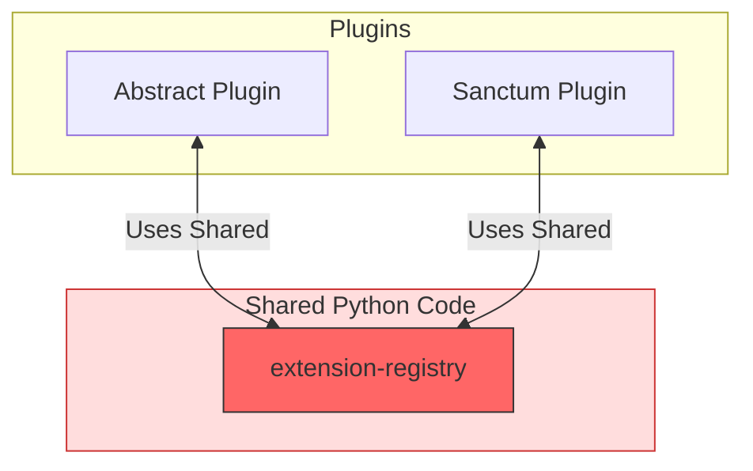
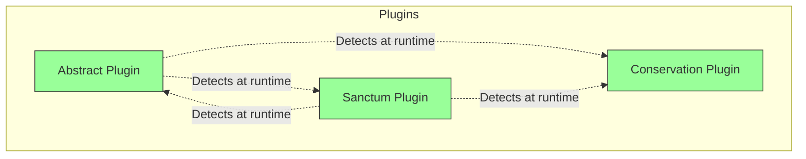
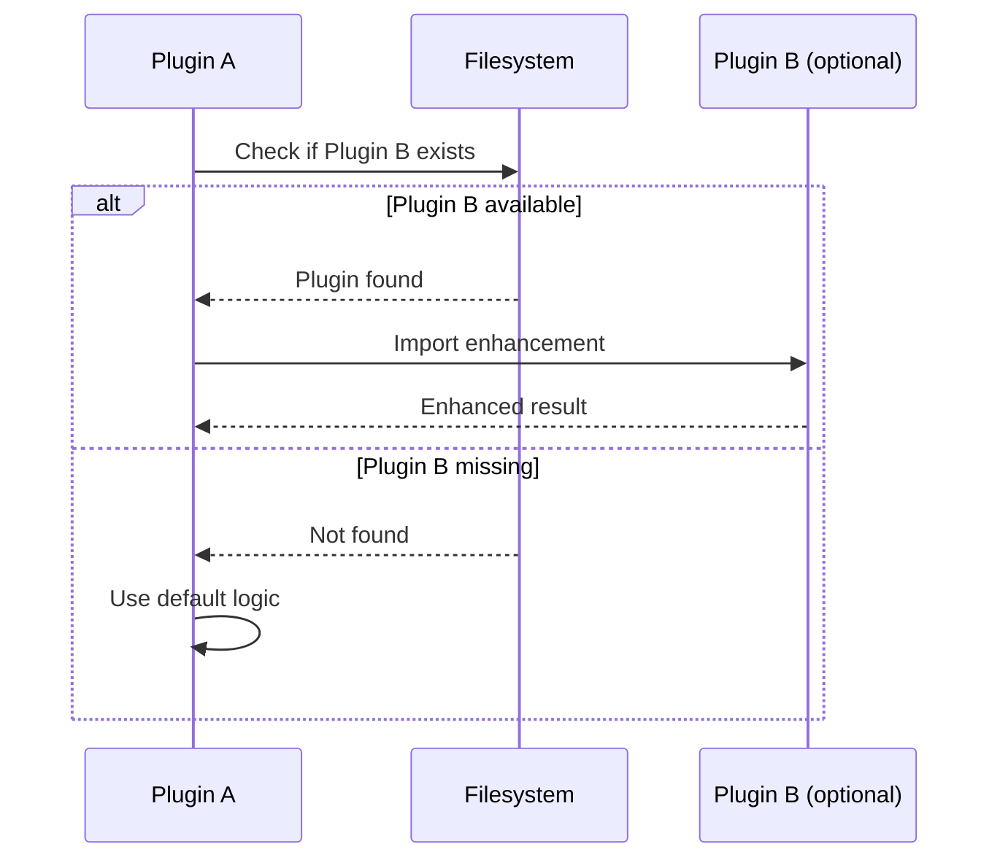

# ADR-0001: Plugin Dependency Isolation

**Date**: 2024-12-14
**Status**: Accepted
**Deciders**: Claude Night Market maintainers

## Context

The plugin ecosystem initially used a shared extension registry
(`/plugins/abstract/src/extension-registry/`) to enable communication between
plugins. This created tight coupling through shared Python dependencies,
leading to:

- Version conflicts between plugins
- Deployment complexity
- Inability to install/remove plugins independently
- Cascading failures when shared code changed

## Decision

We have decided to remove the shared extension registry
and adopt a plugin isolation pattern.
Under this pattern, each plugin detects other plugins at runtime via filesystem
checks and enhances its functionality only when those dependencies are
available. If dependencies are missing,
the plugin must degrade gracefully
and continue to operate using its internal logic.
All optional integrations must be documented clearly so users
and other plugins understand the available enhancements.

### Exception: leyline (intentional)

`leyline` is a shared infrastructure plugin that provides reusable building
blocks (e.g., token estimation, quota tracking, deferred capture)
intended to be imported by other plugins.
Any import of `leyline` must be optional,
typically guarded with a try/except ImportError block,
and must provide a safe secondary behavior so the consumer plugin still loads
and runs without leyline installed.

### Exception: abstract (intentional)

`abstract` is a second infrastructure plugin that provides shared base classes
for cross-plugin reuse (e.g., `tasks_manager_base` for Claude Code Tasks
integration).
Consumers: attune, imbue, sanctum, spec-kit.
The same rules as leyline apply: imports must be guarded with try/except
ImportError and the consumer must degrade gracefully when abstract is absent.

### Exception: herald (intentional)

`herald` is a shared notification library extracted from egregore.
It provides GitHub issue alerts and webhook support (Slack, Discord, generic)
that any plugin may use for operational notifications.
Consumer: egregore.
The same rules as leyline and abstract apply: imports must be guarded
with try/except (or equivalent dynamic loading) and the consumer must
degrade gracefully when herald is absent.
Herald declares no skills, commands or agents, and is used as a
Python library. It does register one hook: `hooks/double_shot_latte.py`
on Stop, which can return `{"decision": "block"}` to keep a session
working when its last message states an intent to continue. It defaults
to stopping, and allows at most `MAX_CONTINUATIONS` (10) blocks in a
300-second window. Installing herald for its notifications installs
that hook as well.

### Exception: gauntlet (recorded 2026-09-03)

`gauntlet` owns the code knowledge graph (`gauntlet.graph`,
`gauntlet.communities`). Consumers: cartograph, whose
`graph_community_refresh.py` PostToolUse hook imports both at runtime
through sys.path injection inside a try/except and is inert when gauntlet
is absent, and pensive, whose performance review and
`pr_blast_radius.py` hook import the graph the same way and drop their
graph output when it is missing. The same rules as leyline, abstract and
herald apply. Both edges were implemented before they were recorded.
cartograph's and pensive's plugin.json declare them, as egregore's
declares herald and minister's declares leyline. The manifest says what
the code does.

### Exception: memory-palace (recorded 2026-10-28)

`memory-palace` owns the knowledge graph analyzer, the embedding
index and the capture index. Consumers: tome, which imports the first
two for thread analysis and semantic retrieval (ADR-0018), and
abstract, which stages insight captures through
`hooks/shared/deduplication`. The same rules apply, and both
plugin.json files declare the edge. `tests/test_plugin_dependency_manifest.py`
pins every runtime edge, so an undeclared one fails there first.

## Architecture

### Before (Shared Registry)

**Problem**: Tight coupling through shared dependencies causes version
conflicts and cascading failures.

### After (Plugin Isolation)

**Solution**: Plugins detect each other at runtime with graceful default
behaviors when dependencies are missing.

## Implementation Pattern

### Mechanism

A plugin finds a sibling with `sibling_plugin_dir` and puts its source
on the path with `add_sibling_src_to_path`, both from
`leyline.sibling_plugins` (vendored into plugins that cannot import
leyline). Each cross-plugin import is guarded, and the caller keeps a
default for when the sibling is absent. The `is_plugin_available` and
`ServiceRegistry` samples this section once held were never built.

## Consequences

This architectural shift makes plugins self-contained and independent,
as they no longer share Python dependencies and can be installed
or removed without affecting others.
Graceful degradation ensures that plugins remain functional even when optional
dependencies are missing.
While this approach requires slightly more boilerplate for detection
and each plugin must implement its own default logic,
it results in a version-safe ecosystem that is better documented
and easier to maintain.

## Migration Guide

To migrate plugins from the old shared registry,
first remove any imports from `extension-registry`
and implement the runtime detection pattern.
You must then add internal default behaviors for missing dependencies
and document these optional integration points.
Finally, verify the plugin's operation both with
and without its optional dependencies to ensure stability.

## Documentation Requirements

Each plugin must document its optional dependencies
and the enhanced features they provide.
It is also necessary to describe the default behavior of the plugin when these
dependencies are unavailable
and define the integration points that allow other plugins to detect its
capabilities.

## Related

- `docs/guides/plugin-dependency-pattern.md` - Detailed implementation guide
- `plugins/attune/scripts/tasks_manager.py` - a live guarded consumer
